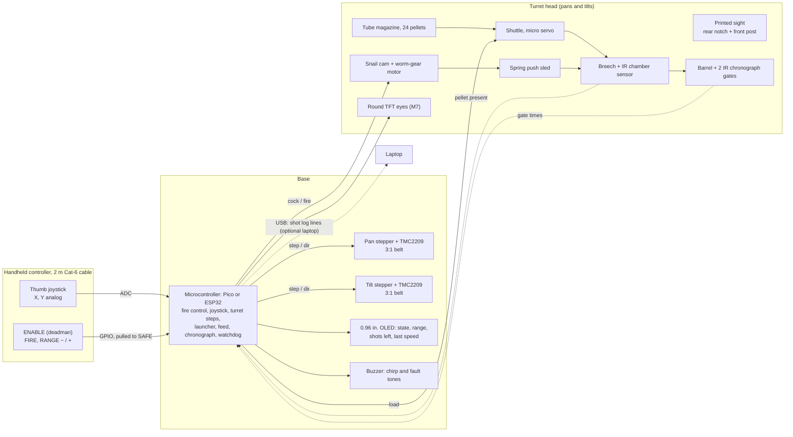
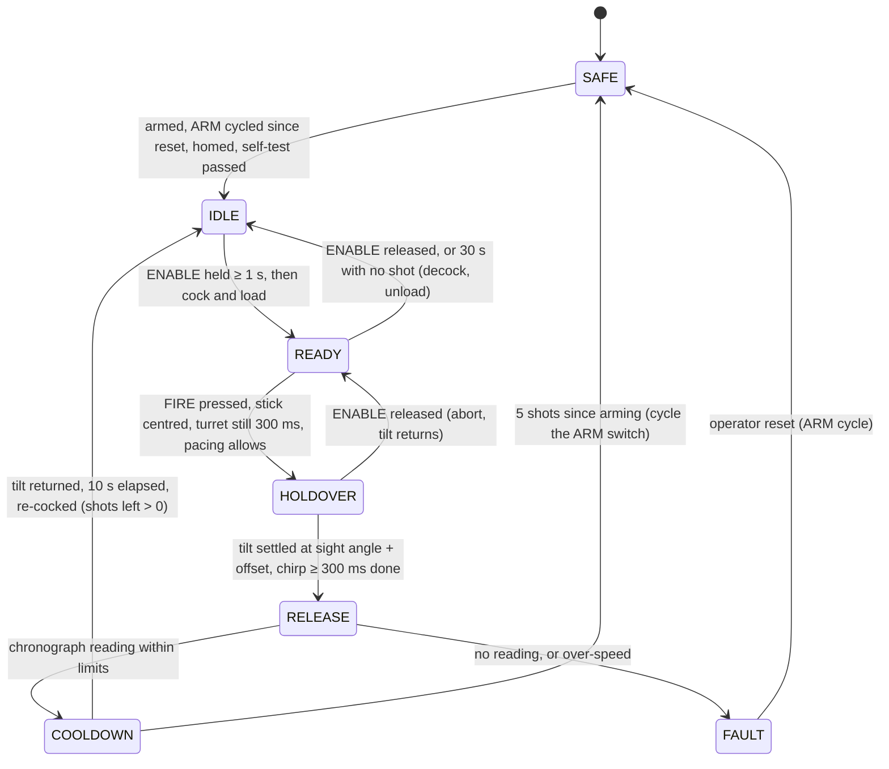
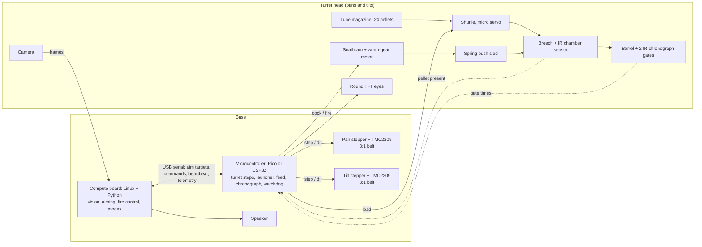
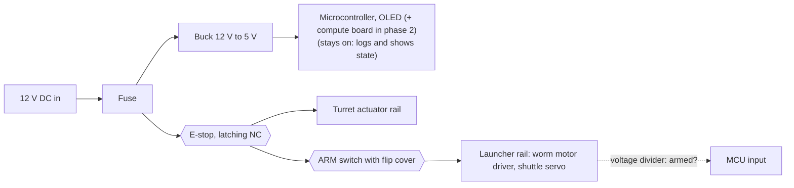
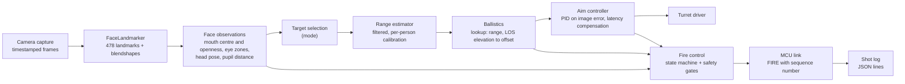
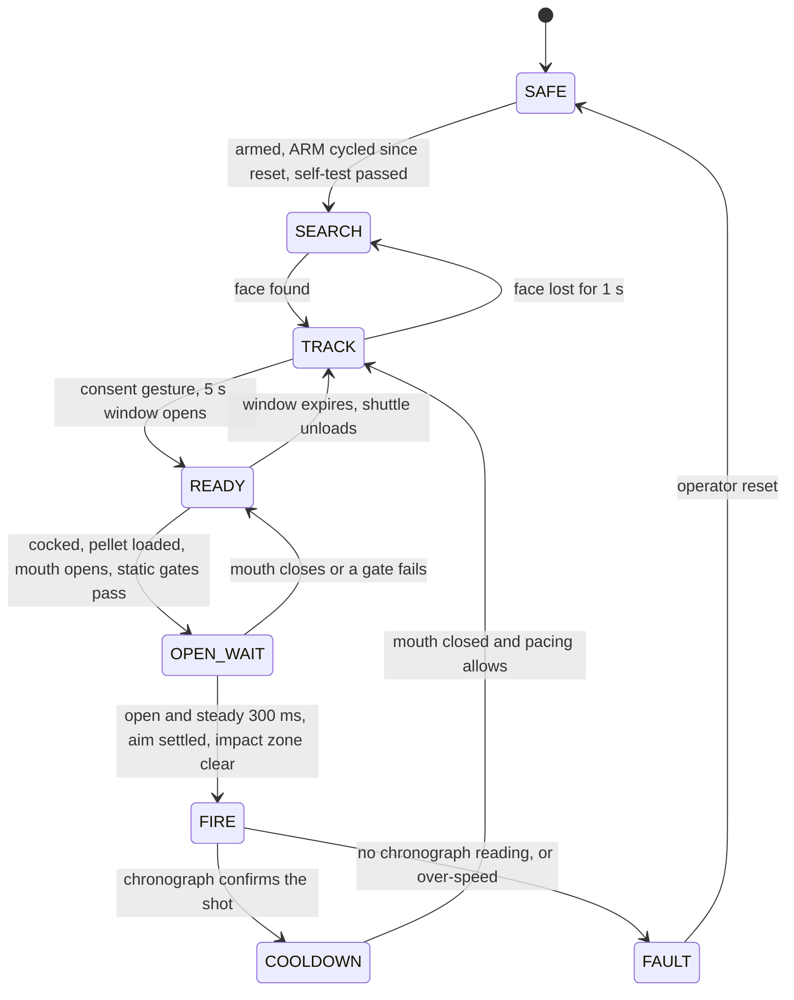

# DESUU: System architecture

Deliverable 1, part one. The launcher trade-off is in [decisions.md](decisions.md#d-001-launcher-snail-cam-spring-push-sled). Board and actuator choices are tracked as D-007 and D-008.

The project runs in two phases ([D-011](decisions.md#d-011-phase-1-joystick-aiming-face-tracking-moves-to-phase-2)):

- **Phase 1, joystick** (this section and the power section): an operator aims with a wired joystick, and the microcontroller does everything, fire control included. There's no camera and no compute board.
- **Phase 2, face tracking** (the sections marked phase 2): a Raspberry Pi 5 with a camera on the head adds auto-aim and the vision safety gates on top of the same mechanics.

## Phase 1 hardware (joystick)



- **Controller wiring.** The eight cores of a Cat-6 patch cable carry 3.3 V, GND, joystick X, joystick Y, ENABLE, FIRE, RANGE − and RANGE +. The buttons pull to ground against pull-ups, but ENABLE is wired so that an open circuit (unplugged or broken) reads as released. The joystick's ADC readings must stay inside a plausible band, otherwise the controller counts as disconnected (REQ-CTL-001).
- **Aiming.** Rate control: stick deflection sets the turret's angular speed, with an 8 % deadband and an expo curve (REQ-CTL-002). The operator sights over the head from behind the robot (REQ-CTL-004).
- **Range and holdover.** RANGE −/+ sets 0.5–2.0 m in 0.1 m steps, shown on the OLED. On FIRE the microcontroller looks up the offset for (set range, current tilt) in the [seed table](research/ballistics.md) (replaced by calibration in M6), tilts up by it, fires, and returns (REQ-CTL-003).
- **Pins.** Phase 1 adds 2 ADC inputs, 4 buttons, I2C for the OLED and a buzzer pin to the launcher, turret and chronograph signals. That nearly fills a Pico; the pin map is part of deliverable 4.

## Phase 1 fire control (microcontroller)

One state machine in the firmware is the only path to a release (REQ-SAF-017). It's plain Python with the hardware behind interfaces, so it runs under pytest on the PC with fakes and under MicroPython on the board.



Any state drops to SAFE when the launcher rail falls (disarm or E-stop), when the controller disconnects, or when the watchdog fires. The joystick moves the turret in IDLE and READY only; in HOLDOVER and RELEASE the stick is ignored.

**Timing, phase 1.**

| Stage | Budget | Notes |
|---|---|---|
| Stick to step rate | ≤ 50 ms | REQ-CTL-002 |
| FIRE to release | ≈ 0.5–1.0 s | Holdover tilt (up to about 19° at 30°/s), settle, 300 ms chirp, cam past the drop (24 ms) |
| Re-cock and reload | ≤ 3 s | REQ-PERF-009 |
| Minimum shot interval | 10 s | REQ-SAF-014 phase 1 form |

## Phase 2 hardware blocks (face tracking)



## Power and interlocks



- The ARM switch and the E-stop are **in series with actuator power**. They are not GPIO reads that software could ignore (REQ-SAF-004, -005).
- Logic power stays up through an E-stop, so the robot can still log, show its state and refuse to resume until reset.
- The power chain is the same in both phases. In phase 1 the 5 V buck feeds only the microcontroller, OLED, eyes and shuttle servo, so it has plenty of headroom; the Pi joins it in phase 2.
- The microcontroller reads the *switched* launcher rail through a divider, so it knows the real armed state, not the switch position.

## Phase 2 software (face tracking)



**Per frame** (target 30 FPS):

1. Capture a frame and stamp it with the capture time.
2. Run FaceLandmarker on the frame (or a crop around the last face).
3. Derive the observations:
   - mouth centre and inner-lip gap ratio, plus the `jawOpen` blendshape;
   - eye zones (eye landmarks + 15 mm);
   - head yaw and pitch;
   - pupil distance in pixels.
4. Update the range filter.
5. Look up the ballistic offset for (range, line-of-sight elevation).
6. The aim setpoint is the aim point shifted *down* in the image by that offset, because the camera rides on the barrel (D-003). The PID moves the turret to drive the aim point onto that setpoint. The turret angle at capture time comes from the actuator position history, so latency doesn't cause overshoot.
7. Fire control evaluates its gates and may send FIRE.

**Fire control, phase 2** (REQ-SAF-001). In phase 2 this state machine runs on the Pi and the microcontroller re-checks it; the phase 1 machine above stays in the firmware as the manual mode. Any state goes to SAFE when the launcher rail drops (disarm or E-stop), and to FAULT on any fault.



The cam cocks on entering READY and decocks (reverse rotation) after 30 s without a shot (REQ-SAF-015).

**Gates checked every frame in OPEN_WAIT** (REQ-SAF-001; all must pass):

1. Armed: the launcher rail is live.
2. Exactly one face in the firing cone, tracked without a break since consent.
3. Mouth open with hysteresis, continuously for 300 ms, with no close-open cycling in the last second (talking, laughing, chewing).
4. Mouth steady: ≤ 15 mm/s.
5. Facing the robot: yaw within ±20°, head tipped back no more than 15°, eyes not shut.
6. Range ≥ 0.5 m and within the eye-safe auto-fire limit.
7. Aim error ≤ 0.15° per axis, averaged over 3 frames, for 100 ms.
8. 3σ impact ellipse clear of both eye zones.
9. Pellet chambered and cam parked.
10. Pacing: ≥ 10 s since this person's last shot, under the session cap, and this mouth opening not yet served.
11. Consent window open for this person.

The microcontroller re-checks the armed rail, heartbeat, token freshness, chamber, cam state and its own 5 s minimum interval (REQ-SAF-006), so a bug on the compute board cannot fire on its own.

## Timing budget (phase 2)

| Stage | Budget | Notes |
|---|---|---|
| Capture and transfer | ≤ 35 ms | Short exposure; good light helps |
| FaceLandmarker | ≤ 40 ms | Per-board numbers in research/vision-compute.md (D-007) |
| Control and command | ≤ 5 ms | |
| Actuator response | ≤ 30 ms | Small corrections once settled |
| **Camera to motion** | **≤ 100 ms** | REQ-PERF-008 |
| Fire decision to release | ≈ 45 ms | USB about 2 ms, cam past the drop about 40 ms, sled stroke about 5 ms |
| Flight at 1 m | ≈ 180 ms | [ballistics](research/ballistics.md) §3 |

## Microcontroller protocol (draft)

In phase 1 the USB port only reports: `STAT`, `SHOT` and `FAULT` lines (plus a JSON shot log), for a laptop to record if one is plugged in. Nothing received over USB can fire. The commands below arrive with the Pi in phase 2.

Line-based ASCII over USB CDC, each line `<seq> <CMD> [args] *<crc8>`, at 115200 baud or native USB speed.

| Direction | Message | Meaning |
|---|---|---|
| Board → MCU | `HB <board_ms>` | Heartbeat every 50 ms, carrying the board's clock; the MCU drops to SAFE after 200 ms of silence |
| Board → MCU | `AIM <pan_mdeg> <tilt_mdeg>` | Turret target angles, sent every frame; the MCU ramps the steppers within speed and acceleration limits |
| MCU → Board | `POS <mcu_us> <pan_mdeg> <tilt_mdeg>` | Turret angles at 100 Hz, so the board knows where the camera pointed when each frame was captured |
| Board → MCU | `COCK` / `DECOCK` | Turn the cam forward to the parked, cocked position, or reverse to relax the spring |
| Board → MCU | `LOAD` / `UNLOAD` | Shuttle one pellet against the sled face, or return it under the stack |
| Board → MCU | `FIRE <frame_ms>` | Release. Accepted once per sequence number, and only if armed, heartbeat fresh, the frame ≤ 100 ms old by the board clock, chambered, parked and ≥ 5 s since the last shot |
| Board → MCU | `SAFE` | Stop every actuator |
| MCU → Board | `STAT armed cam chamber mag` | State, sent 10 times a second |
| MCU → Board | `SHOT <seq> <t1_us> <t2_us> <v_mps>` | Chronograph result for each shot |
| MCU → Board | `FAULT <code>` | Over-speed, jam, cam timeout, watchdog |

## Planned repository layout

```text
firmware/           phase 1: MicroPython for the microcontroller
  fire_control.py   the phase 1 state machine (pure Python, tested on the PC)
  joystick.py       deadband, expo, rate limits, disconnect detection
  holdover.py       ballistic table lookup (range × tilt)
  turret.py, launcher.py, feed.py, chrono.py, ui.py (OLED, buzzer)
desuu/              phase 2: Python package that runs on the Pi and on the PC
  vision/           camera back ends, FaceLandmarker wrapper, mouth-open, eye zones, range estimate
  control/          PID, visual-servo aim controller, latency compensation
  ballistics/       lookup table, model, calibration fit
  fire/             fire-control state machine and safety gates
  hw/               turret and microcontroller drivers plus fakes for --sim
  modes/            auto-serve, table service, manual target
  app.py            main loop
cad/                CAD sources plus STEP/STL exports
config/             desuu.yaml (tunables), calibration.yaml (per robot)
tests/              pytest, safety gates first (phase 1: firmware/fire_control.py)
tools/              ballistics_sim.py, calibration scripts
docs/               brief, requirements, architecture, decisions, safety, roadmap, research
```
